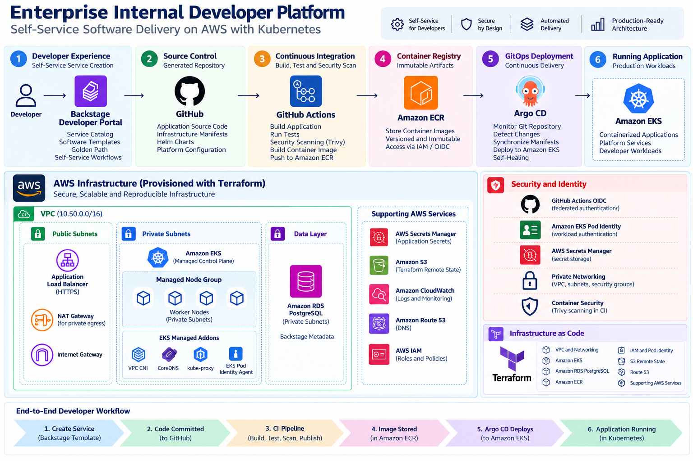

# Enterprise Internal Developer Platform


Production-style **Internal Developer Platform (IDP)** built on AWS and Kubernetes to provide developers with a standardized, self-service path from service creation to production-style deployment.

The platform combines **Backstage, Amazon EKS, Terraform, GitHub Actions, Argo CD, Helm, Amazon ECR, PostgreSQL, External Secrets and AWS workload identity** to demonstrate platform engineering and Golden Path principles.

---

## Project Objective

Modern engineering organizations frequently suffer from fragmented developer workflows.

Developers may need to understand:

- cloud infrastructure
- Kubernetes manifests
- CI/CD pipelines
- container registries
- secrets management
- deployment conventions
- GitOps repositories
- organizational standards

before they can deploy even a simple service.

This project addresses that problem by implementing an Internal Developer Platform that provides an opinionated **Golden Path** for application delivery.

The target developer experience is:

```text
Developer
    |
    v
Backstage Developer Portal
    |
    v
Software Template / Golden Path
    |
    +--> Generate service repository
    |
    v
GitHub
    |
    v
GitHub Actions CI
    |
    +--> Build
    +--> Test
    +--> Security Scan
    +--> Container Image
    |
    v
Amazon ECR
    |
    v
GitOps Configuration
    |
    v
Argo CD
    |
    v
Amazon EKS
    |
    v
Running Application
```

## Architecture




The platform separates responsibilities across several layers:

| Layer                | Technology                             | Responsibility                                  |
| -------------------- | -------------------------------------- | ----------------------------------------------- |
| Developer Experience | Backstage                              | Portal, catalog and software templates          |
| Infrastructure       | Terraform                              | Reproducible AWS infrastructure                 |
| Container Platform   | Amazon EKS                             | Kubernetes runtime                              |
| CI                   | GitHub Actions                         | Build, test and security validation             |
| Registry             | Amazon ECR                             | Immutable container artifacts                   |
| GitOps               | Argo CD                                | Declarative Kubernetes delivery                 |
| Packaging            | Helm                                   | Reusable application deployment model           |
| Secrets              | AWS Secrets Manager + External Secrets | Secret lifecycle and Kubernetes synchronization |
| Identity             | AWS IAM / EKS Pod Identity             | Workload-to-AWS authentication                  |
| Database             | Amazon RDS PostgreSQL                  | Backstage persistent metadata                   |
| Security             | Trivy + IAM + private networking       | Supply-chain and runtime controls               |

Detailed architecture: [docs/architecture.md](docs/architecture.md)

---

## Platform Engineering Principles Demonstrated

This project demonstrates:

- Internal Developer Platform design
- developer self-service
- Golden Paths
- platform-as-a-product thinking
- Infrastructure as Code
- GitOps
- immutable artifacts
- workload identity
- centralized secrets management
- Kubernetes application delivery
- reusable Helm packaging
- CI security gates
- environment standardization
- separation of platform and application concerns
- reproducible infrastructure lifecycle

---

## Infrastructure as Code

The AWS foundation is provisioned using Terraform.

Major infrastructure includes:

- VPC
- multi-AZ public and private subnets
- Internet Gateway
- NAT Gateway
- Amazon EKS
- managed EKS node group
- EKS managed addons
- Amazon RDS PostgreSQL
- Amazon ECR
- IAM roles and policies
- EKS Pod Identity
- GitHub Actions OIDC federation
- AWS Secrets Manager integration

---

## Terraform Rebuild Validation

The runtime infrastructure was intentionally destroyed and subsequently reconstructed from Terraform to validate infrastructure reproducibility.

---

## Amazon EKS Platform

Application and platform workloads run on Amazon EKS.

The cluster uses:

- managed worker nodes
- private worker networking
- VPC CNI
- CoreDNS
- kube-proxy
- EKS Pod Identity Agent
- IAM-based workload identity

Implementation details: [docs/implementation.md](docs/implementation.md)

---

## Backstage Developer Portal

Backstage provides the developer-facing interface for the platform.

It provides:

- service discovery
- software catalog
- Golden Path templates
- standardized service metadata
- developer self-service workflows

---

## Golden Path — Self-Service Service Creation

Developers can create a standardized microservice through a Backstage Software Template.

The Golden Path automates the repetitive platform integration required for a new workload.

The workflow creates standardized application assets rather than requiring each developer to design infrastructure and delivery conventions independently.

See: [docs/developer-workflow.md](docs/developer-workflow.md)

---

## CI/CD and GitOps

CI and CD responsibilities are intentionally separated.

```text
GitHub Actions
      |
      | CI
      v
Build / Test / Scan
      |
      v
Amazon ECR
      |
      | immutable image
      v
GitOps Configuration
      |
      v
Argo CD
      |
      | reconciliation
      v
Amazon EKS
```
GitHub Actions handles continuous integration while Argo CD handles continuous deployment through GitOps.

---

## Security Architecture

Security controls are implemented across multiple layers.

### Identity

AWS IAM and EKS Pod Identity provide workload authentication without embedding long-lived AWS credentials in Kubernetes workloads.

### Secrets

AWS Secrets Manager acts as the external source of truth for sensitive configuration.

External Secrets synchronizes approved secrets into Kubernetes.

### Container Security

Container images are scanned using Trivy before deployment.

### Network Security
- EKS workers operate in private subnets.
- RDS is not publicly accessible.
- Kubernetes workloads access AWS services using workload identity.
- Internet-facing access is separated from internal workload networking.

Detailed controls: `docs/security.md`

End-to-End Developer Workflow
```text
1. Developer opens Backstage
             |
2. Selects Golden Path template
             |
3. Supplies service metadata
             |
4. Platform generates standardized service
             |
5. Source repository is created
             |
6. GitHub Actions runs CI
             |
7. Container image is published to ECR
             |
8. GitOps configuration defines desired state
             |
9. Argo CD reconciles Kubernetes
             |
10. Application runs on EKS
```
Full workflow: `docs/developer-workflow.md`

---

## Evidence of Platform Operation

The project was validated through an end-to-end rebuild and runtime verification.

Evidence includes:

```text
- Terraform infrastructure reconstruction
- EKS control plane validation
- worker-node readiness
- EKS addon health
- RDS availability
- Backstage runtime
- Backstage software catalog
- Golden Path service generation
- GitHub Actions CI
- ECR image publication
- Argo CD reconciliation
- External Secrets synchronization
- application deployment
```
Machine-readable and terminal validation evidence is retained under:
`docs/evidence/`

---

## Repository Structure

```text
.
├── backstage/          # Backstage developer portal
├── diagrams/           # Architecture diagrams
├── docs/               # Architecture, security and operational documentation
├── gitops/             # Argo CD / GitOps desired state
├── helm/               # Reusable Golden Path Helm chart
├── kubernetes/         # Kubernetes platform/application resources
├── scripts/            # Platform automation
├── security-reports/   # Security scanner reports
├── templates/          # Backstage software templates
└── terraform/          # AWS Infrastructure as Code
```

---

## Documentation

```text
.
├── backstage/          # Backstage developer portal
├── diagrams/           # Architecture diagrams
├── docs/               # Architecture, security and operational documentation
├── gitops/             # Argo CD / GitOps desired state
├── helm/               # Reusable Golden Path Helm chart
├── kubernetes/         # Kubernetes platform/application resources
├── scripts/            # Platform automation
├── security-reports/   # Security scanner reports
├── templates/          # Backstage software templates
└── terraform/          # AWS Infrastructure as Code
```
---

## Key Engineering Outcomes

The project demonstrates how a platform engineering team can reduce developer cognitive load by moving infrastructure and deployment complexity behind standardized self-service workflows.

Rather than requiring every application team to independently understand Terraform, EKS, IAM, Helm, CI/CD and GitOps, the platform provides reusable abstractions and paved roads.

The resulting operating model is:

**Developers own applications. Platform engineering owns the delivery platform. Git defines desired state. Automation performs the repetitive work.**

---

## Portfolio Context

This project was developed as a production-style platform engineering implementation demonstrating hands-on experience with:

**AWS · EKS · Kubernetes · Terraform · Backstage · GitHub Actions · Argo CD · Helm · ECR · RDS PostgreSQL · External Secrets · IAM · DevSecOps · GitOps**