# Enterprise Internal Developer Platform

A production-oriented **Internal Developer Platform (IDP)** built on AWS that
provides developers with a standardized self-service Golden Path from service
creation to container delivery and Kubernetes deployment.

The platform combines **Backstage, Amazon EKS, Terraform, GitHub Actions,
Amazon ECR, Argo CD, External Secrets Operator, Amazon RDS PostgreSQL, and
AWS-native workload identity** to demonstrate practical platform engineering
patterns.

---

## Project Overview

Application teams often need to understand and manually coordinate many
platform concerns before they can deploy a service:

- repository structure
- CI pipelines
- container builds
- cloud authentication
- container registries
- Kubernetes manifests
- GitOps configuration
- secrets
- service ownership
- documentation
- runtime visibility

This creates cognitive load for developers and encourages teams to implement
the same infrastructure patterns differently.

This project addresses that problem by introducing an Internal Developer
Platform where the **platform team owns reusable infrastructure and delivery
mechanisms**, while developers consume those capabilities through a
standardized self-service workflow.

The primary developer interface is **Backstage**.

---

## Architecture


The platform is organized around several architectural layers:

### Developer Experience

- Backstage Developer Portal
- Software Catalog
- Software Templates
- Scaffolder
- TechDocs
- Kubernetes integration
- GitHub OAuth

### Continuous Integration

- GitHub Actions
- automated testing
- security validation
- GitHub-to-AWS OIDC federation
- container builds
- immutable commit-derived image tags
- Amazon ECR publication

### Continuous Delivery

- Argo CD
- GitOps reconciliation
- Kubernetes desired state
- application health and synchronization

### Runtime Platform

- Amazon EKS
- managed node group
- private worker networking
- EKS managed addons
- EKS Pod Identity
- AWS Load Balancer Controller
- External Secrets Operator

### AWS Infrastructure

- Amazon VPC
- public and private subnets
- NAT Gateway
- Application Load Balancer
- Amazon RDS PostgreSQL
- AWS Secrets Manager
- Amazon ECR
- Route 53
- AWS Certificate Manager
- IAM
- S3 Terraform remote state

For the detailed architecture and design rationale, see
[Architecture](docs/architecture.md).

---

## Golden Path

The primary platform workflow allows a developer to move from an application
idea to a standardized deployable service without manually assembling the
underlying platform integrations.

```text
Developer
    |
    v
Backstage Developer Portal
    |
    v
Software Template
    |
    v
Backstage Scaffolder
    |
    v
Generated GitHub Repository
    |
    v
GitHub Actions CI
    |
    v
Amazon ECR
    |
    v
Argo CD
    |
    v
Amazon EKS
```

The generated service repository includes the baseline application,
containerization, CI, catalog metadata, documentation, and platform
configuration required by the Golden Path.

---

## Backstage Developer Portal

Backstage provides the developer-facing abstraction over the underlying
platform.

The implementation includes:

- GitHub OAuth authentication
- Software Catalog
- service ownership metadata
- Software Templates
- Scaffolder
- TechDocs
- Kubernetes integration
- generated-service registration

The production-style portal was exposed through HTTPS at:

```text
https://backstage.kapilkumaria.com
```

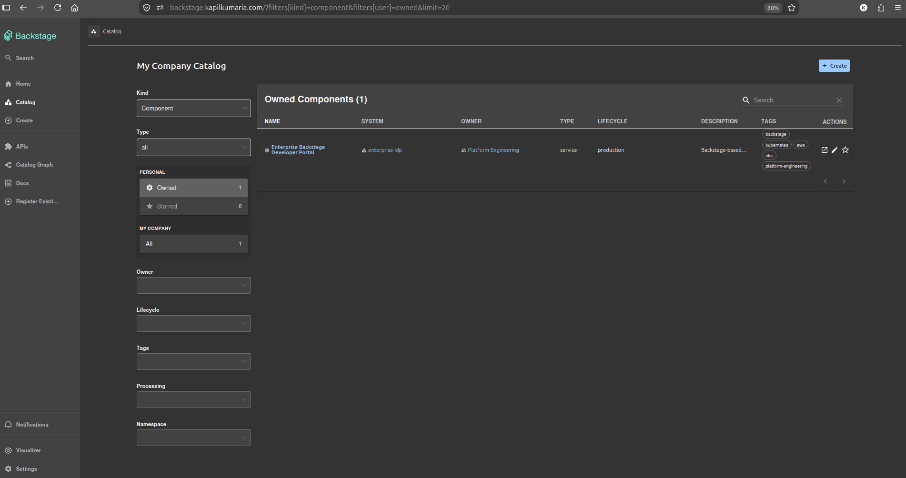

The Software Catalog provides a centralized view of platform and generated
services.

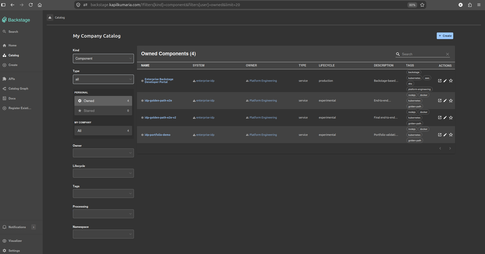

---

## Self-Service Service Creation

Developers create services through a Backstage Software Template instead of
manually creating repositories and delivery configuration.

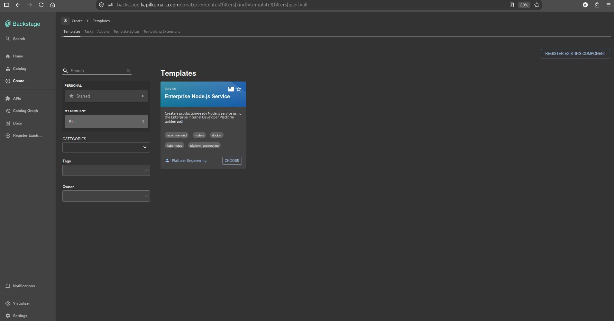

The Scaffolder provisions the standardized repository and registers the
resulting component.

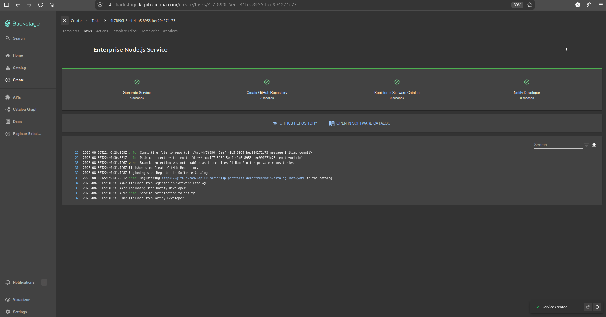

A generated service repository contains the expected Golden Path assets.

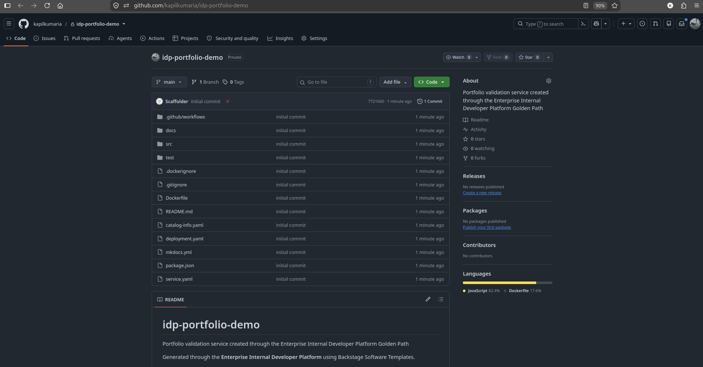

This turns platform standards into reusable automation rather than relying on
documentation alone.

---

## CI/CD Architecture

The platform deliberately separates **continuous integration** from
**continuous delivery**.

### GitHub Actions — CI

GitHub Actions performs:

1. source checkout
2. runtime setup
3. dependency installation
4. automated tests
5. security validation
6. AWS authentication through OIDC
7. Amazon ECR authentication
8. container build
9. immutable image tagging
10. container publication

The final clean Golden Path CI workflow completed successfully.

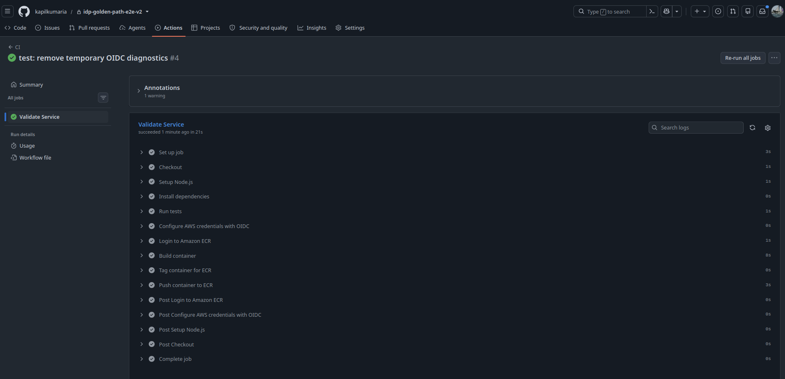

### Argo CD — CD

Argo CD owns Kubernetes deployment reconciliation.

It continuously compares Git desired state with the Kubernetes runtime and
reports synchronization and application health.

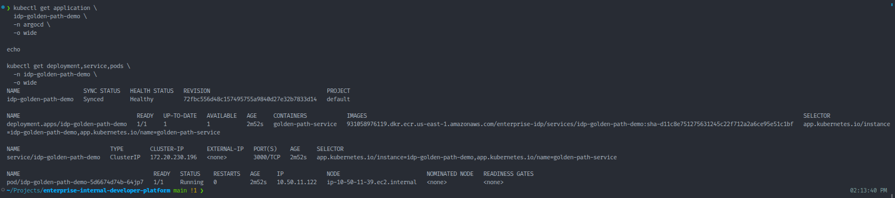

This design prevents the CI pipeline from becoming the Kubernetes deployment
control plane.

---

## Key Security Controls

Security is implemented across multiple platform layers.

| Security Area | Implementation |
|---|---|
| Developer authentication | GitHub OAuth |
| CI-to-AWS authentication | GitHub Actions OIDC |
| CI authorization | Dedicated IAM role |
| Kubernetes-to-AWS authentication | EKS Pod Identity |
| AWS authorization | Workload-specific IAM roles |
| Secret storage | AWS Secrets Manager |
| Kubernetes secret delivery | External Secrets Operator |
| Kubernetes API authorization | ServiceAccount + RBAC |
| Database exposure | Private Amazon RDS PostgreSQL |
| Worker-node exposure | Private subnets |
| External access | ALB + ACM HTTPS |
| Artifact traceability | Commit-derived immutable image tags |
| Kubernetes delivery | Argo CD GitOps |
| Terraform state | Protected S3 remote backend |

### GitHub Actions OIDC

The Golden Path CI workflow does not require long-lived AWS access keys.

GitHub Actions obtains temporary AWS credentials using OpenID Connect.

```text
GitHub Actions
      |
      v
GitHub OIDC
      |
      v
AWS IAM Trust Policy
      |
      v
Temporary AWS Credentials
```

The project also diagnosed and corrected a real OIDC trust-policy mismatch
caused by customized GitHub OIDC subject claims.

### EKS Pod Identity

AWS-aware Kubernetes components use workload identity instead of inheriting
broad AWS permissions from worker nodes.

```text
Kubernetes ServiceAccount
          |
          v
EKS Pod Identity
          |
          v
Dedicated IAM Role
          |
          v
Authorized AWS Service
```

### External Secrets

AWS Secrets Manager remains the external secret authority.

External Secrets Operator synchronizes authorized values into Kubernetes
using its dedicated workload identity.

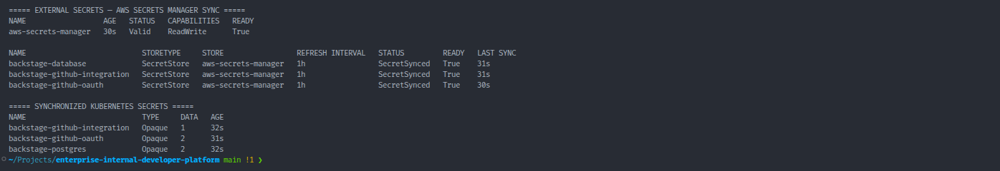

For the complete security model, see [Security Architecture](docs/security.md).

---

## Infrastructure as Code

AWS infrastructure is provisioned using Terraform.

The implementation covers:

- VPC networking
- public/private subnet architecture
- EKS
- EKS addons
- managed node group
- IAM
- workload identity
- Amazon ECR
- Amazon RDS PostgreSQL
- GitHub Actions OIDC
- supporting AWS infrastructure

Terraform state is stored in a dedicated S3 backend.

The bootstrap/state layer is intentionally separated from runtime
infrastructure so the runtime platform can be destroyed and reconstructed
without destroying the state foundation.

A complete platform rebuild was performed successfully.

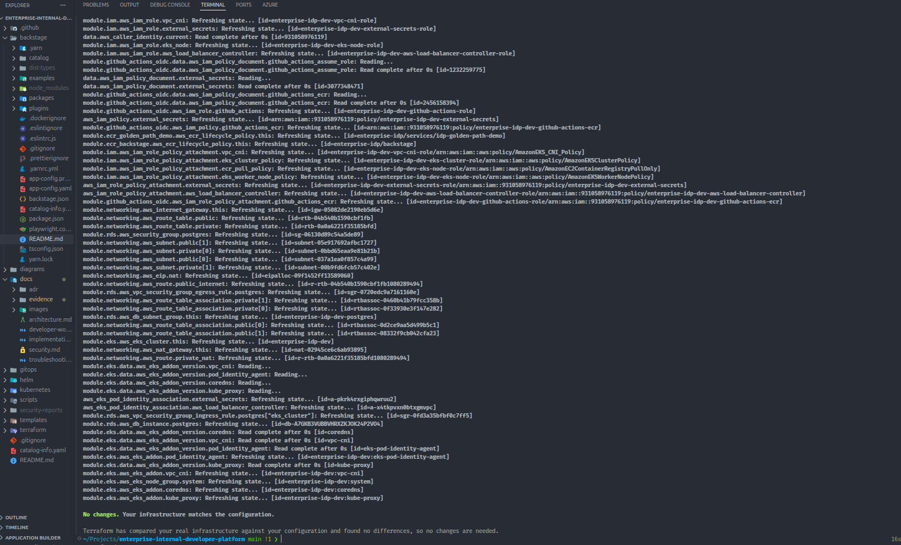

---

## Amazon EKS Runtime

Amazon EKS provides the Kubernetes runtime for both platform components and
generated application workloads.

The final environment validated healthy managed worker nodes:

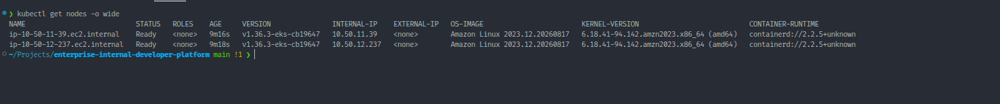

The platform uses Kubernetes-native integrations including:

- Argo CD
- External Secrets Operator
- AWS Load Balancer Controller
- Kubernetes RBAC
- ServiceAccounts
- Ingress
- Helm

---

## Private PostgreSQL Persistence

Backstage uses Amazon RDS PostgreSQL for persistent application metadata.

The database is deployed in private network infrastructure and is not
directly internet-facing.

RDS manages the master credential through AWS Secrets Manager.

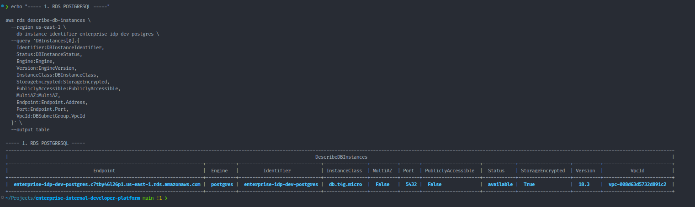

---

## HTTPS Ingress

Backstage is exposed using:

```text
Route 53
    |
    v
Application Load Balancer
    |
    v
AWS Certificate Manager
    |
    v
HTTPS
    |
    v
Kubernetes Ingress
    |
    v
Backstage
```

The public HTTPS endpoint and ALB target health were validated before final
teardown.

---

## Immutable Container Delivery

The Golden Path CI workflow publishes generated service images to Amazon ECR.

Images use commit-derived tags so the artifact can be traced back to the
source revision that created it.

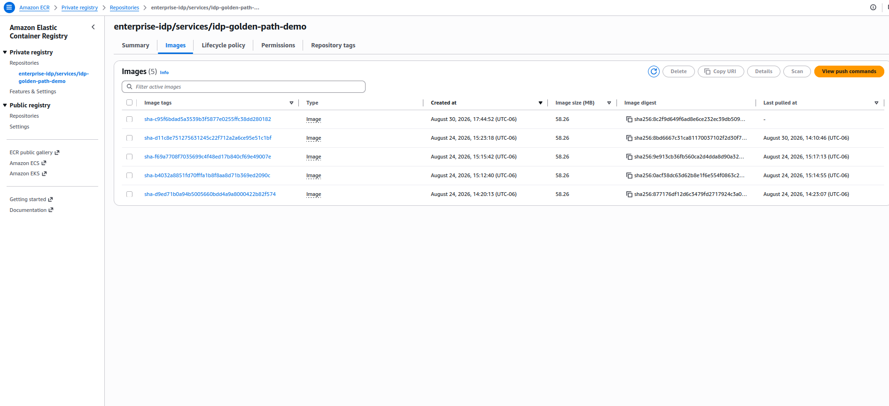

The final validation demonstrated the complete path:

```text
Git Commit
    |
    v
GitHub Actions
    |
    v
AWS OIDC
    |
    v
Container Build
    |
    v
Immutable ECR Image
```

---

## Technology Stack

| Category | Technology |
|---|---|
| Cloud | AWS |
| Infrastructure as Code | Terraform |
| Kubernetes | Amazon EKS |
| Developer Portal | Backstage |
| Source Control | GitHub |
| Continuous Integration | GitHub Actions |
| Continuous Delivery | Argo CD |
| Container Registry | Amazon ECR |
| Application Packaging | Helm / Kubernetes manifests |
| Database | Amazon RDS PostgreSQL |
| Secrets | AWS Secrets Manager |
| Kubernetes Secret Integration | External Secrets Operator |
| Workload Identity | Amazon EKS Pod Identity |
| CI Federation | GitHub Actions OIDC |
| Ingress | AWS Load Balancer Controller / ALB |
| DNS | Amazon Route 53 |
| TLS | AWS Certificate Manager |
| Container Security | Trivy |
| Documentation | Backstage TechDocs |
| Terraform State | Amazon S3 |

---

## Repository Structure

```text
.
├── .github/
│   └── workflows/
├── backstage/
├── diagrams/
│   └── enterprise-internal-developer-platform-architecture.png
├── docs/
│   ├── adr/
│   ├── evidence/
│   ├── images/
│   ├── architecture.md
│   ├── developer-workflow.md
│   ├── implementation.md
│   ├── security.md
│   └── troubleshooting.md
├── gitops/
├── helm/
├── kubernetes/
├── scripts/
├── security-reports/
├── templates/
└── terraform/
    ├── bootstrap/
    ├── environments/
    └── modules/
```

---

## Architecture Decisions

Significant architectural decisions are documented as ADRs.

| ADR | Decision |
|---|---|
| [ADR-0001](docs/adr/0001-platform-architecture.md) | Internal Developer Platform architecture |
| [ADR-0002](docs/adr/0002-eks-workload-identity.md) | Use EKS Pod Identity for AWS workload authentication |
| [ADR-0003](docs/adr/0003-use-amazon-eks.md) | Use Amazon EKS as the Kubernetes runtime |

---

## Implementation Challenges Solved

The project included several real integration and troubleshooting scenarios.

Examples include:

- EKS worker nodes remaining `NotReady`
- VPC CNI identity/dependency issues
- External Secrets IAM permissions
- RDS PostgreSQL SSL requirements
- GitHub OAuth configuration
- Backstage GitHub integration permissions
- TechDocs runtime dependencies
- Backstage Kubernetes RBAC
- Argo CD private repository authentication
- nested Backstage/GitHub Actions template expressions
- customized GitHub OIDC subject claims
- IAM trust-policy mismatch
- Terraform detailed-exit-code handling
- evidence-safe infrastructure teardown

These are documented with root cause and remediation in
[Troubleshooting](docs/troubleshooting.md).

---

## Final Validation

The completed platform was validated across the full lifecycle.

### Infrastructure

- Terraform provisioning completed successfully
- EKS worker nodes reached `Ready`
- required EKS addons became active
- private RDS PostgreSQL was operational
- HTTPS ingress was healthy

### Developer Experience

- Backstage portal operational
- GitHub OAuth authentication successful
- Software Catalog operational
- Software Template available
- Scaffolder successfully generated services
- generated services registered in the catalog
- TechDocs operational
- Kubernetes integration operational

### Security

- GitHub Actions OIDC federation successful
- EKS Pod Identity operational
- External Secrets synchronized successfully
- Backstage Kubernetes access restricted through RBAC
- RDS remained private
- HTTPS/TLS validated

### Delivery

- Golden Path repository generated
- tests passed
- CI completed successfully
- AWS OIDC authentication succeeded
- container image built
- immutable image published to ECR
- Argo CD application synchronized
- application reported healthy

Representative final platform evidence:

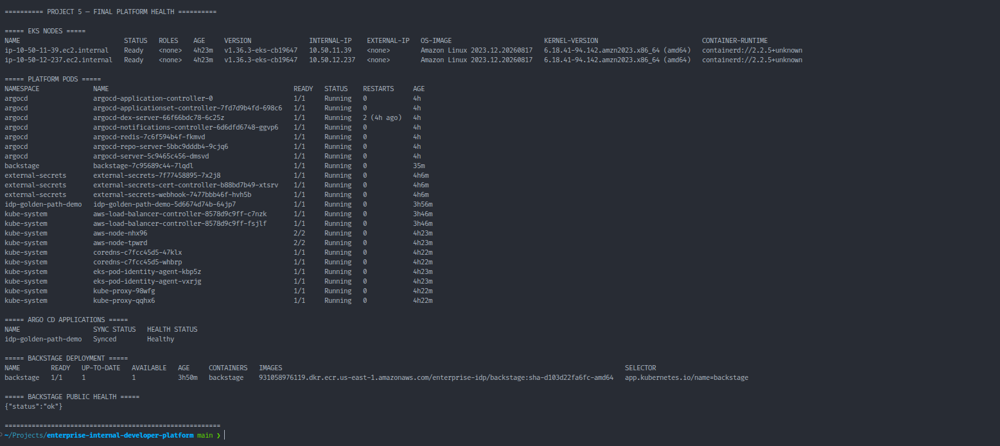

---

## Terraform Drift Validation

Before teardown, the Terraform-managed runtime environment was checked using
a detailed Terraform plan.

The result was:

```text
No changes. Your infrastructure matches the configuration.
```

This confirmed that the live Terraform-managed infrastructure matched the
source-controlled desired state at the final validation checkpoint.

Evidence:

```text
docs/evidence/phase-30-terraform-drift-check.txt
```

---

## Controlled Teardown

The AWS runtime environment was intentionally destroyed after final
validation and evidence capture to avoid unnecessary cloud charges.

Pre-destroy evidence captured the operational platform state.

Post-destroy verification confirmed removal of the Project 5 runtime
resources included in the final checks, including:

- EKS
- ECR
- Secrets Manager runtime secrets
- project VPC
- NAT Gateways
- Application Load Balancers
- project-tagged runtime resources

The Terraform bootstrap/state infrastructure was intentionally retained.

Post-destroy evidence:

```text
docs/evidence/destroy/post-destroy-aws-verification.txt
```

This demonstrates both sides of the infrastructure lifecycle:

```text
Reproducible Provisioning
          +
Operational Validation
          +
Drift Validation
          +
Controlled Destruction
```

---

## Documentation

Detailed engineering documentation is available here:

- [Architecture](docs/architecture.md)
- [Developer Workflow](docs/developer-workflow.md)
- [Implementation](docs/implementation.md)
- [Security Architecture](docs/security.md)
- [Troubleshooting](docs/troubleshooting.md)
- [Architecture Decision Records](docs/adr/README.md)
- [Screenshot Evidence Index](docs/images/README.md)

---

## Key Engineering Outcomes

This project demonstrates:

- Internal Developer Platform architecture
- platform engineering operating model
- Backstage-based developer self-service
- reusable Golden Path service creation
- Infrastructure as Code with Terraform
- managed Kubernetes with Amazon EKS
- GitHub Actions CI
- GitHub-to-AWS OIDC federation
- immutable container delivery
- Amazon ECR artifact management
- Argo CD GitOps
- EKS Pod Identity
- External Secrets integration
- private managed PostgreSQL
- Kubernetes least-privilege RBAC
- HTTPS ingress
- source-controlled architecture decisions
- infrastructure drift validation
- controlled cloud-resource teardown

The key outcome is not simply that a Kubernetes application can run.

The platform demonstrates how a platform engineering team can provide a
**secure, repeatable, self-service path from application creation to a
running Kubernetes workload while abstracting infrastructure complexity from
the developer**.
