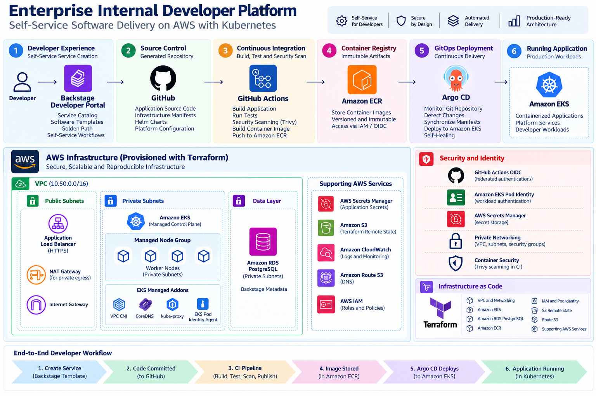

# Architecture

## Overview

The Enterprise Internal Developer Platform is designed as a layered platform in which infrastructure provisioning, developer experience, CI, artifact management and Kubernetes deployment have clearly separated responsibilities.



---

## Architecture Goals

The architecture was designed around the following goals:

1. Developer self-service
2. Standardized application delivery
3. Reproducible infrastructure
4. GitOps-based deployment
5. Short-lived workload credentials
6. Centralized secrets management
7. Private workload networking
8. Reusable deployment abstractions
9. Separation between CI and CD
10. Reduced developer cognitive load

---

## Architecture Layers

### Developer Experience Layer

Backstage acts as the entry point into the platform.

Responsibilities include:

- software catalog
- service ownership metadata
- software templates
- Golden Path workflows

### Continuous Integration Layer

GitHub Actions performs:

- source validation
- application build
- automated testing
- container image build
- security scanning
- ECR publication

GitHub Actions authenticates to AWS through OIDC rather than stored long-lived AWS access keys.

### Artifact Layer

Amazon ECR stores immutable container artifacts.

The registry acts as the boundary between CI and runtime deployment.

### GitOps Layer

Argo CD continuously compares the desired Kubernetes state stored in Git with the actual state running in EKS.

This provides:

- declarative deployment
- reconciliation
- drift detection
- deployment traceability

### Kubernetes Runtime Layer

Amazon EKS provides the Kubernetes control plane.

Worker nodes run in private subnets and host platform and application workloads.

### Data Layer

Amazon RDS PostgreSQL provides persistent metadata storage for Backstage.

The database is private and is not exposed directly to the Internet.

### Identity and Secrets Layer

AWS IAM and EKS Pod Identity provide AWS authentication to workloads.

AWS Secrets Manager provides external secret storage.

External Secrets provides controlled synchronization into Kubernetes.

---

## Network Architecture

```text
Internet
   |
Internet Gateway
   |
Public Subnets
   |
NAT / Load Balancer
   |
Private Subnets
   |
+-----------------------+
| EKS Worker Nodes      |
| Backstage             |
| Platform Controllers  |
| Applications          |
+-----------------------+
          |
          v
    Private RDS
```
Two Availability Zones are used to demonstrate failure-domain separation.

---

## Deployment Architecture

```text
Developer
   |
Backstage
   |
GitHub Repository
   |
GitHub Actions
   |
Amazon ECR
   |
GitOps desired state
   |
Argo CD
   |
Amazon EKS
```
---

## Infrastructure Lifecycle

The platform distinguishes between durable and ephemeral infrastructure.

## Durable resources

Examples:

- ECR repositories
- IAM roles
- GitHub OIDC provider
- selected secrets and identity configuration

## Ephemeral runtime resources

Examples:

- VPC
- NAT Gateway
- EKS
- worker nodes
- RDS

This separation allows expensive runtime resources to be destroyed when not required and reconstructed using Terraform.