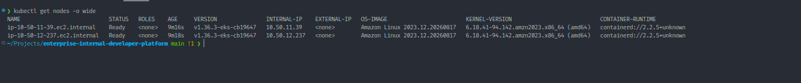

# Troubleshooting Guide

## Purpose

This document records significant implementation issues encountered while
building the **Enterprise Internal Developer Platform**.

The goal is not simply to list errors.

Each issue documents:

- symptom
- root cause
- diagnosis
- remediation
- engineering lesson

This provides evidence that the platform was validated through real
integration failures rather than only through static configuration.

---

# 1. EKS Worker Nodes NotReady

## Symptom

After provisioning Amazon EKS and the managed node group, worker nodes did
not reach a healthy `Ready` state.

Kubernetes system components showed symptoms including:

- `aws-node` failures
- CoreDNS scheduling issues
- worker nodes remaining `NotReady`

## Root Cause

The Amazon VPC CNI did not have the correct AWS identity and permissions
available early enough in the cluster lifecycle.

Because the CNI is responsible for pod networking, failures at this layer
prevent normal node and pod readiness.

## Remediation

The implementation was corrected by introducing a dedicated IAM role and
Amazon EKS Pod Identity association for the VPC CNI-related AWS access and by
ensuring the required EKS addon/identity dependencies existed before the node
group relied on them.

The final cluster reached healthy node state.



## Engineering Lesson

Kubernetes node readiness can fail because of dependencies below the
application layer.

When EKS nodes are `NotReady`, validate:

```text
Node condition
    |
    v
kube-system pods
    |
    v
VPC CNI health
    |
    v
IAM / workload identity
    |
    v
subnet and routing configuration
```
Do not assume the problem is the EC2 instance itself.

---

# 2. EKS Addon Dependency Ordering

## Symptom

Managed node initialization depended on platform networking components that
were not yet fully functional.

## Root Cause

Terraform resource creation order did not initially express all operational
dependencies required by EKS networking and workload identity.

Cloud resources can technically exist while the Kubernetes runtime is still
not operationally ready.

## Remediation

Terraform dependency relationships were refined so required addons and
identity associations were available in the appropriate order.

The final managed addons became active.

## Engineering Lesson

Infrastructure dependency management must consider runtime dependency
order, not merely whether an AWS API accepted resource creation.

---

# 3. External Secrets Could Not Discover RDS Secret

## Symptom

External Secrets Operator was unable to successfully resolve the intended
AWS Secrets Manager secret.

## Root Cause

The IAM policy did not initially include all permissions required by the
implemented secret-discovery mechanism.

The design used AWS-managed RDS secret metadata/tags rather than permanently
hardcoding a generated RDS secret ARN.

The External Secrets identity therefore required discovery capabilities in
addition to direct secret retrieval.

## Remediation

The IAM policy was updated with the required Secrets Manager permissions,
including capabilities required for discovery and retrieval.

The RDS-managed secret was identified using project metadata.

The resulting ExternalSecret synchronized successfully.

## Engineering Lesson

Least privilege does not mean guessing the smallest possible policy.

It means determining the exact API calls required by the real application
workflow and granting only those capabilities.

---

# 4. Secret Hash Validation Appeared Incorrect

## Symptom

A comparison between the AWS secret value and the synchronized Kubernetes
secret initially appeared to produce different hashes.

## Root Cause

The comparison method introduced a newline into one side of the hash input.

The secret values themselves were not different.

## Remediation

The comparison was repeated using a newline-safe approach equivalent to:

```bash
printf '%s' "$VALUE" | sha256sum
```
The resulting hashes matched.

## Engineering Lesson

When validating secrets, hashes, signatures, or encoded values, control
exact byte representation.

A newline can create an apparent data mismatch even when the underlying
credential is correct.

---

# 5. Backstage Could Not Connect to RDS PostgreSQL

## Symptom

Backstage failed during database connection with an error similar to:

`no pg_hba.conf entry ... SSL off`

## Root Cause

The RDS PostgreSQL configuration required SSL, while the Backstage production
database client was attempting a non-SSL connection.

## Remediation

The Backstage production database configuration was updated to enable the
required PostgreSQL SSL behavior.

Backstage subsequently connected successfully.

## Engineering Lesson

A successful TCP connection does not mean database authentication and
transport settings are correct.

For managed PostgreSQL, validate:

- hostname
- port
- security groups
- credentials
- database name
- SSL requirements

as separate layers.

---

# 6. GitHub OAuth Returned 404

## Symptom

Backstage GitHub authentication redirected to an invalid GitHub OAuth path
and returned a 404-style failure.

## Root Cause

The configured GitHub OAuth client ID contained a transcription error.

A character in the client ID had been entered incorrectly.

## Remediation

The GitHub OAuth App configuration and the AWS Secrets Manager value were
corrected.

Backstage was redeployed with the valid client ID and authentication
succeeded.

## Engineering Lesson

OAuth failures are not always application-code failures.

Validate the complete chain:

```text
Backstage provider configuration
        |
        v
Client ID
        |
        v
Client secret
        |
        v
Homepage URL
        |
        v
Callback URL
        |
        v
Provider backend module
```
---

# 7. Backstage GitHub Auth Provider Module Missing

## Symptom

Backstage authentication configuration existed, but the GitHub auth provider
was not fully available in the backend runtime.

## Root Cause

The generated Backstage application required the GitHub authentication
backend module to be explicitly installed and registered.

## Remediation

The required GitHub auth backend module was installed and added to the
Backstage backend.

GitHub OAuth subsequently operated correctly.

## Engineering Lesson

Modern Backstage uses modular backend/plugin registration.

Configuration alone does not guarantee that the corresponding backend module
is present in the runtime.

---

# 8. Backstage User Identity Resolution

## Symptom

Successful external authentication did not automatically guarantee a usable
Backstage application identity.

## Root Cause

Backstage needs to map the authenticated GitHub account to an entity in the
Software Catalog.

## Remediation

A catalog user entity was created and the GitHub sign-in resolver was
configured to match the GitHub username to the Backstage user entity.

The resulting identity resolved to the expected user and ownership group.

## Engineering Lesson

Authentication and identity resolution are distinct concerns:

```text
Who authenticated?
        |
        v
Who are they inside Backstage?
        |
        v
What catalog ownership do they have?
```
---

# 9. GitHub Integration Token Invalid or Empty

## Symptom

Backstage could authenticate users but private GitHub repository operations
did not work correctly.

## Root Cause

The GitHub integration PAT stored for Backstage was initially invalid or did
not contain the expected usable value.

## Remediation

A new fine-grained GitHub token was created with the required repository
permissions and the AWS Secrets Manager secret was updated.

The Backstage GitHub integration subsequently worked.

## Engineering Lesson

Backstage GitHub OAuth and Backstage GitHub repository integration are
separate concerns and may use separate credentials.

A working login does not prove repository API access is correctly
configured.

---

# 10. TechDocs GitHub 403

## Symptom

TechDocs processing failed while attempting to access GitHub repository
metadata.

The request returned HTTP `403`.

## Root Cause

The fine-grained GitHub integration token did not have sufficient permission
for the repository API endpoint required by the TechDocs workflow.

The missing capability involved commit-status access.

## Remediation

The token permissions were expanded only to include the required read
permission.

TechDocs subsequently generated and served the documentation successfully.

## Engineering Lesson

When using fine-grained tokens, troubleshoot the exact failed API operation.

Do not replace a narrowly scoped token with a broad unrestricted credential
simply to make the integration work.

---

# 11. TechDocs Tooling Missing from Backstage Container

## Symptom

Backstage could expose TechDocs functionality, but the runtime image lacked
the local documentation-generation tooling required by the configured
builder.

## Root Cause

The initial Backstage container contained the application runtime but not all
Python/MkDocs/TechDocs dependencies required for local generation.

## Remediation

The Backstage container image was extended to include the required
documentation-generation tooling.

The corrected image was rebuilt, published, and deployed.

## Engineering Lesson

Containerizing an application requires packaging not only the primary runtime
but also any runtime build/generation dependencies used by enabled plugins.

---

# 12. Backstage Image Rollout Required Correction

## Symptom

A Backstage deployment required a corrected application image/configuration
before the final platform state became healthy.

## Root Cause

Application-level integration changes required a new container build and
deployment rollout.

## Remediation

The corrected Backstage image was built and published to Amazon ECR, and the
Kubernetes deployment was rolled out using the corrected image.

## Engineering Lesson

For containerized platforms, configuration and plugin changes should be
validated through the same immutable image and deployment lifecycle used for
normal application changes.

---

# 13. Backstage Kubernetes Integration and RBAC

## Symptom

Backstage Kubernetes integration required API access while maintaining a
least-privilege security model.

## Risk

Granting cluster-admin would have solved access problems quickly but would
have given the developer portal excessive Kubernetes permissions.

## Remediation

The implementation used:

- dedicated ServiceAccount
- namespaced Role
- RoleBinding
- read-only permissions

Authorization was validated using Kubernetes access checks.

## Engineering Lesson

Do not solve integration problems by bypassing authorization design.

Validate the exact verbs and resources required and grant only those.

---

# 14. Argo CD Port-Forward Connection Reset

## Symptom

Port-forwarding the Argo CD server and attempting to access it using HTTPS
resulted in a connection reset.

## Root Cause

The Argo CD server was configured to run in insecure mode internally, meaning
the service endpoint behind the port-forward expected plain HTTP.

The attempted port-forward targeted the HTTPS service port/protocol
combination incorrectly.

## Remediation

The UI was accessed using the HTTP service path, for example:

`kubectl port-forward svc/argocd-server -n argocd 8080:80`

and:

`http://localhost:8080`

## Engineering Lesson

A Kubernetes Service port name does not by itself prove the application
protocol expected by the backend process.

Validate how the server is actually configured.

----

# 15. Argo CD Private Repository Authentication

## Symptom

Argo CD required access to a private GitHub repository.

Embedding the repository token directly into GitOps manifests would have
violated the project's secret-management model.

## Remediation

A dedicated GitHub credential was stored in AWS Secrets Manager and delivered
to Argo CD through External Secrets.

The final GitOps application reached healthy synchronized state.

## Engineering Lesson

Platform components should consume secrets through the same controlled secret
delivery model expected from application workloads.

---

# 16. Backstage Template Corrupted GitHub Actions Expressions


## Symptom

A service generated by the Backstage Software Template contained an invalid
GitHub Actions workflow.

Rendered values included symptoms such as:

```text
role-to-assume:
aws-region:
ECR_URL: NaN
```

## Root Cause

Backstage fetch:template interpreted GitHub Actions ${{ ... }}
expressions as template expressions during scaffolding.

The GitHub Actions expressions therefore did not survive repository
generation unchanged.

## Remediation

The Software Template was corrected so GitHub Actions expressions were
preserved through the Backstage templating process.

The Backstage image/template was rebuilt and redeployed.

A newly generated test repository was then used to validate the fix.

## Engineering Lesson

When one templating system generates configuration for another templating
system, expression syntax can collide.

Always inspect the rendered artifact, not only the source template.

---

# 17. GitHub Actions OIDC AssumeRole Failure

## Symptom

The generated service CI workflow reached the AWS authentication stage but
failed to assume the intended IAM role.

## Initial Assumption

The trust policy initially expected a standard GitHub OIDC subject similar to:

`repo:owner/repository:ref:refs/heads/main`

## Root Cause

The GitHub account used customized OIDC subject claims.

The actual observed subject contained immutable owner and repository IDs,
with a structure similar to:

`repo:kapilkumaria@42500918/idp-golden-path-e2e-v2@1351818072:ref:refs/heads/main`

The AWS IAM trust policy therefore did not match the real identity presented
by GitHub.

## Diagnosis

The OIDC token claims were inspected during a temporary diagnostic CI step.

The observed claim was compared directly with the IAM trust policy rather
than continuing to guess at the expected subject.

## Remediation

Terraform was updated so the IAM trust pattern matched the customized GitHub
OIDC identity format while remaining restricted to the intended owner and
branch.

The final trust pattern was equivalent to:

`repo:kapilkumaria@42500918/*@*:ref:refs/heads/main`

The CI workflow subsequently authenticated successfully.

## Engineering Lesson

For federated identity failures, inspect the token actually being presented.

IAM trust policy debugging should compare:

```text
issuer
audience
subject
condition operator
condition value
```
against the real JWT claims.

---

# 18. Temporary OIDC Diagnostics Removed

## Situation

A diagnostic workflow step was temporarily used to understand the customized
GitHub OIDC claims.

Leaving diagnostics in the final production-style CI workflow would create
unnecessary complexity and potentially expose identity metadata.

## Remediation

After the IAM trust policy was corrected and validated, the diagnostic step
was removed.

A clean CI run was executed afterward.

## Engineering Lesson

Diagnostic instrumentation is valuable during incident resolution, but
temporary diagnostics should be removed after the root cause is established.

---

# 19. Final ECR Artifact Validation

## Objective

A successful CI status alone was not considered sufficient proof of the
delivery workflow.

The resulting artifact was also validated in Amazon ECR.

## Result

The final generated service image was published using a commit-derived tag.

## Engineering Lesson

Validate delivery pipelines at the artifact boundary:

```text
Source
  |
  v
CI Success
  |
  v
Registry Artifact
  |
  v
Expected Tag / Digest
```
A green CI job does not necessarily prove the artifact exists where the
runtime expects it.

---

# 20. Terraform Detailed Exit Code Handling

## Situation

Terraform drift validation used:

`terraform plan -detailed-exitcode`

Terraform uses:

```text
0 = no changes
1 = error
2 = changes present
```
A shell configured to terminate automatically on any non-zero return code can
incorrectly treat exit code 2 as an unexpected script failure before the
result is evaluated.

## Remediation

The Terraform exit code was explicitly captured and interpreted rather than
blindly relying on shell failure behavior.

The final validation returned:

`0`
with:

`No changes. Your infrastructure matches the configuration.`

## Engineering Lesson

Automation must understand the exit-code semantics of the tool being wrapped.

Non-zero does not universally mean operational failure.

---

# 21. Shell Validation Blocks Exiting the Terminal

## Symptom

Some long validation command blocks caused the integrated shell session to
terminate.

## Root Cause

The validation blocks contained strict shell behavior or explicit
`exit 0` / `exit 1` statements.

When pasted directly into an interactive VS Code terminal, `exit` terminated
the shell itself.

## Remediation

Subsequent validation commands were written to:

- print `PASS`
- print `WARNING`
- capture return codes
- avoid explicit shell termination

## Engineering Lesson

Commands intended for an interactive operator terminal should behave
differently from scripts intended for non-interactive CI execution.

Operational tooling should be safe for its intended execution context.

---

# 22. Runtime Teardown Without Losing Evidence

## Challenge

The AWS runtime environment generated ongoing cost, but destroying it too
early would eliminate useful evidence needed for portfolio documentation.

## Approach

The teardown was treated as an explicit lifecycle phase:

```text
Validate Platform
      |
      v
Capture Screenshots
      |
      v
Capture AWS Inventory
      |
      v
Capture Kubernetes Inventory
      |
      v
Terraform Drift Validation
      |
      v
Destroy Runtime Infrastructure
      |
      v
Post-Destroy Verification
```

The Terraform bootstrap/state infrastructure was intentionally retained.

## Result

Post-destroy checks confirmed removal of the Project 5 runtime resources that
were queried during final verification.

Evidence is retained under:

```text
docs/evidence/
docs/images/screenshots/
```
## Engineering Lesson

Infrastructure teardown is part of platform engineering.

A mature implementation should prove both:

`Can I create it reproducibly?`

and:

`Can I retire it safely?`

---

# Troubleshooting Methodology

Across the project, troubleshooting generally followed this sequence:

```text
1. Capture the exact symptom
          |
          v
2. Identify the failing layer
          |
          v
3. Inspect actual runtime state
          |
          v
4. Compare actual vs expected configuration
          |
          v
5. Form a narrow root-cause hypothesis
          |
          v
6. Make the minimum corrective change
          |
          v
7. Re-run the failing operation
          |
          v
8. Validate downstream behavior
          |
          v
9. Capture evidence
          |
          v
10. Remove temporary diagnostics
```
This prevents random configuration changes and keeps remediation traceable.

---

# Key Engineering Lessons

The implementation reinforced several platform engineering principles:

- cloud resource creation does not automatically mean runtime readiness
- identity failures should be diagnosed from actual claims and trust policies
- workload identity is preferable to broad node-level AWS permissions
- secret values should remain outside Git and Terraform source
- fine-grained credentials require exact API-permission analysis
- templating systems must be validated using generated output
- CI and CD should have distinct responsibilities
- successful pipelines should be validated at the artifact and runtime layers
- Kubernetes access should use least-privilege RBAC
- managed database transport requirements must be explicitly configured
- infrastructure should be tested for both creation and destruction
- temporary debugging mechanisms should not remain in final production-style
workflows

The troubleshooting history is therefore part of the project's engineering
evidence, not merely a record of mistakes.